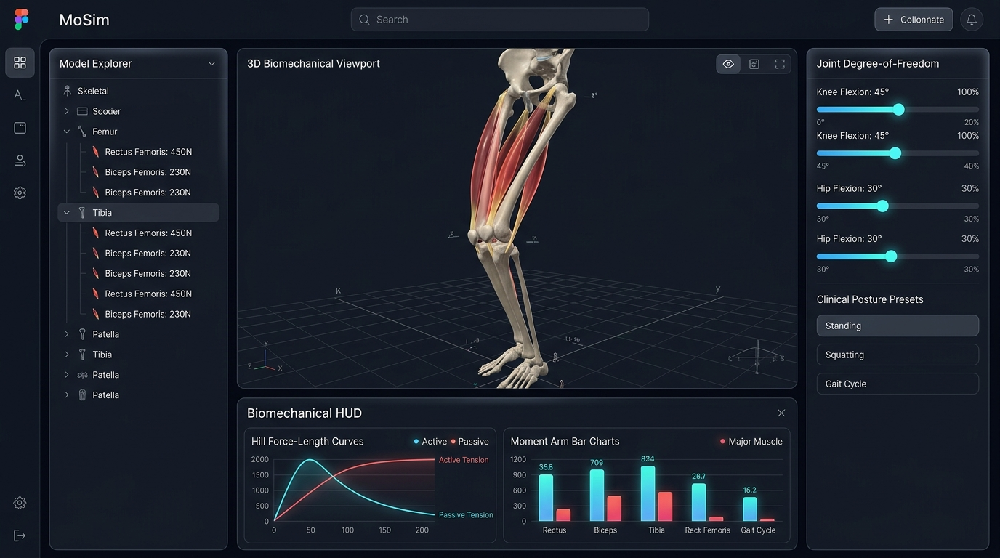
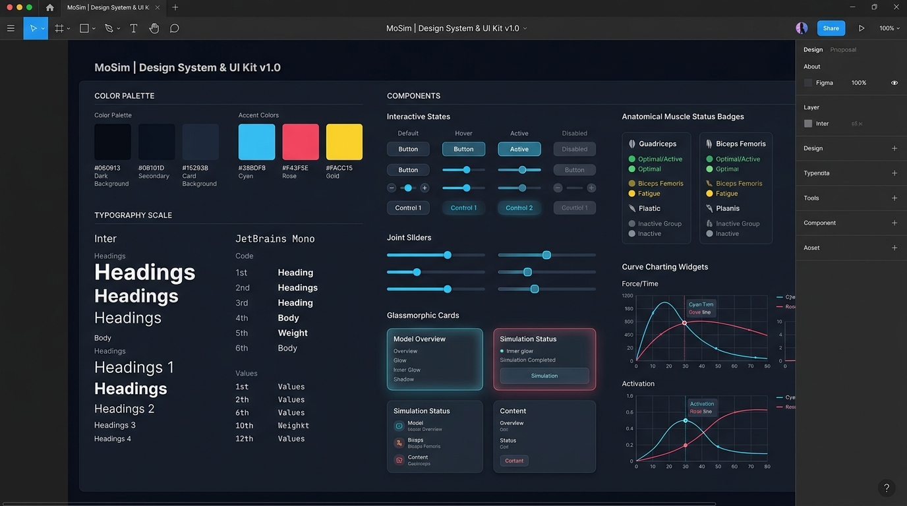

# MoSim: Next-Generation Web Musculoskeletal Biomechanics Simulator & Modeling Engine

[](LICENSE)
[](https://github.com/rawansayed/MoSim)
[]()
[]()

> **MoSim** is a high-performance, web-native virtual musculoskeletal simulator engineered to match and surpass legacy desktop tools (such as OpenSim 4.5) by providing instant browser-based 3D modeling, physically grounded bone-tendon-muscle simulation, interactive biomechanical coordinate inspection, and modern glassmorphic visualization.

---

## 🎨 Figma UI/UX Design & Architecture

| Desktop Application Viewport (Figma) | Design System & UI Kit (Tokens) |
| :---: | :---: |
|  |  |

> 📐 **Figma Design Tokens & Specs:** Complete tokens and Auto Layout guides are available in [`design/FIGMA_SPECIFICATIONS.md`](design/FIGMA_SPECIFICATIONS.md) and [`design/figma_tokens.json`](design/figma_tokens.json) for 1-click import into Figma!

---

## 🌟 Key Features

1. **Zero-Install WebGL 3D Biomechanics Viewport**
   - High-fidelity Three.js Physically Based Rendering (PBR) with ground contact grid, realistic bone ivory textures, and multi-angle camera presets (Sagittal, Frontal, Oblique, Superior).
   - 3D Catmull-Rom muscle belly tubes that dynamically expand radially during contraction to preserve physiological muscle volume.
   - Tendon aponeurosis transitions (glistening silver-white) and active tension glow heatmaps.

2. **Complete 3-Element Hill Musculotendon Model**
   - Physiologically validated active force-length curve $f_L(\tilde{l}_m)$.
   - Hyperbolic force-velocity curve $f_V(\tilde{v}_m)$.
   - Exponential passive elastic force-length curve $f_{PE}(\tilde{l}_m)$ representing titin and collagen stiffness.
   - Series elastic tendon strain curve $f_T(\epsilon_t)$ with toe and linear elastic regimes.
   - Dynamic constant-thickness pennation angle geometry ($\cos\alpha = \sqrt{1 - (w/l_m)^2}$).
   - First-order neural excitation-activation kinetics ($\dot{a} = (u - a)/\tau$).

3. **Live Biomechanical Curve Inspector & HUD**
   - Docked real-time canvas displaying active, passive, and total Hill curves.
   - **Dynamic Operating-Point Tracker:** A pulsing glowing cursor actively traces the exact muscle operating point on the curve as you scrub joint sliders!
   - Generalized moment arm spectrum chart ($r = -\partial l_{mt}/\partial q$) across Knee, Hip, and Ankle degrees of freedom.

4. **Multi-DOF Joint Kinematics & Gait Cycle Replay**
   - Smooth sliders for Hip Flexion/Extension, Adduction/Abduction, Internal/External Rotation, Knee Flexion, and Ankle Plantarflexion/Dorsiflexion.
   - Built-in clinical posture presets: Neutral Stance, Mid-Stance, Toe-Off, Deep Squat, and Hamstring Stretch.
   - Real-time kinematic replay of normal human walking gait (Rajagopal et al. 2016 dataset).

5. **Static Optimization (Muscle Force Sharing)**
   - Resolves the muscular redundancy problem for target joint moments using quadratic programming:
     $$\min \sum_{m=1}^{M} \left( \frac{F_m}{F_{0,m}^{\max}} \right)^2 \quad \text{s.t.} \quad \sum_{m=1}^{M} r_{m, j} F_m = \tau_{target, j}$$

---

## 📐 Mathematical & Biomechanical Formulations

### 1. Musculotendon Unit (MTU) Equilibrium
$$l_{mt} = l_t + l_m \cos\alpha$$
$$F_t = F_m \cos\alpha = \left[ a(t) \cdot f_L\left(\frac{l_m}{l_0^m}\right) \cdot f_V\left(\frac{v_m}{v_{\max}}\right) + f_{PE}\left(\frac{l_m}{l_0^m}\right) \right] F_0^{\max} \cos\alpha$$

### 2. Active Force-Length Curve
$$f_L(\tilde{l}_m) = \exp\left( -\left(\frac{\tilde{l}_m - 1}{\gamma}\right)^2 \right), \quad \gamma = 0.45$$

### 3. Passive Elastic Force-Length Curve
$$f_{PE}(\tilde{l}_m) = \frac{\exp\left( \frac{k^{pe} (\tilde{l}_m - 1)}{\epsilon_0^m} \right) - 1}{\exp(k^{pe}) - 1} \quad (\tilde{l}_m > 1)$$

### 4. Generalized Moment Arm (Virtual Work)
$$r_{m, j}(q) = -\frac{\partial l_{mt}(q)}{\partial q_j}$$

---

## 📥 Downloads & Releases

| Package | Download Link | Description |
| :--- | :--- | :--- |
| **MoSim v1.0.0 Release ZIP** | [**Download MoSim_Release_v1.0.0.zip (1.28 MB)**](https://github.com/rawansayed/MoSim/releases/download/v1.0.0/MoSim_Release_v1.0.0.zip) | Standalone offline bundle with Three.js, models, and 1-click runner. |
| **GitHub Release v1.0.0** | [**View Release v1.0.0 on GitHub**](https://github.com/rawansayed/MoSim/releases/tag/v1.0.0) | Official release notes and source code archives (`.zip`, `.tar.gz`). |
| **Source Code Repository** | [**GitHub Repository rawansayed/MoSim**](https://github.com/rawansayed/MoSim) | Git repository for cloning and contributing. |

---

## 🚀 Quick Start & How to Test

### Method A: 1-Click Desktop Runner (Windows)
1. Download and extract [**`MoSim_Release_v1.0.0.zip`**](https://github.com/rawansayed/MoSim/releases/download/v1.0.0/MoSim_Release_v1.0.0.zip) (or clone the repository).
2. Double-click **`run_mosim.bat`**.
3. MoSim automatically starts the local simulation server and opens in your default browser at `http://127.0.0.1:8090/index.html`!

### Method B: Directly in Browser
- Open `index.html` directly in Google Chrome, Microsoft Edge, Firefox, or Safari. All Three.js dependencies are bundled offline in `vendor/` with zero installation required!

### Method C: Lightweight Dev Server
```bash
git clone https://github.com/rawansayed/MoSim.git
cd MoSim
python -m http.server 8090
```
Open `http://localhost:8090/index.html`.

---

## 🧪 Interactive Testing Guide

1. **Multi-Model Switching:**
   - In the top navigation bar, use the model dropdown to switch between **Lower Extremity** (Pelvis-Femur-Patella-Tibia-Foot, 10 MTUs) and **Upper Limb** (Arm & Elbow 3-DOF, 6 MTUs).
2. **Real-Time Kinematic Scrubbing:**
   - Drag the **Knee Angle** slider to watch the Patella glide over the femoral condyles and the Rectus Femoris muscle belly stretch in real time.
   - Notice the yellow operating-point dot in the bottom HUD tracing the active/passive Hill curve!
3. **Runge-Kutta 4 Forward Dynamics Physics:**
   - Click the **⚡ Forward Dynamics** button. Stimulate the quadriceps or hamstrings using the excitation sliders and watch muscle tension accelerate the skeletal segment dynamically against gravity ($I \ddot{q} = \tau_{\text{muscle}} - \tau_{\text{gravity}} - b \dot{q}$).
4. **Motion Simulation Replay:**
   - Click **▶ Play Motion** to replay normalized physiological human walking gait (Rajagopal 2016 dataset) or dynamic elbow flexion cycles.
5. **OpenSim 4.x Interoperability:**
   - Click **📁 Export .osim** to download a standard OpenSim 4.x `.osim` XML model file.
   - Click **📊 Export .mot** to download motion capture trajectory files compatible with OpenSim's Plotter and Motion tools.
6. **3D High-DPI Snapshot:**
   - Click **📷 Snapshot** to save a publication-ready transparent PNG screenshot of your 3D biomechanical scene.

---

## 📂 Project Architecture

```
MoSim/
├── index.html           # Modern glassmorphic application UI & 3D canvas
├── styles.css           # PBR design tokens, responsive layout, custom slider CSS
├── biomechanics.js      # Multibody kinematics, 3-element Hill model, Upper/Lower limb, RK4
├── plotter.js           # Real-time SVG/Canvas Hill curves & moment arm visualizer
├── app.js               # Three.js 3D viewport, Catmull-Rom muscle tubes, animation
├── run_mosim.bat        # 1-Click desktop runner for Windows
├── vendor/              # Bundled offline dependencies (three.min.js, OrbitControls.js)
├── design/              # Figma UI mockups, design tokens JSON, and specifications
├── SRS.md               # IEEE 830-compliant Software Requirements Specification
└── README.md            # Comprehensive documentation and quick start guide
```

---

## 📜 Specifications & Documentation
A complete IEEE 830 / ISO 29148 Software Requirements Specification (SRS) is available in [SRS.md](SRS.md).

## 📄 License
This project is open-source under the MIT License.
